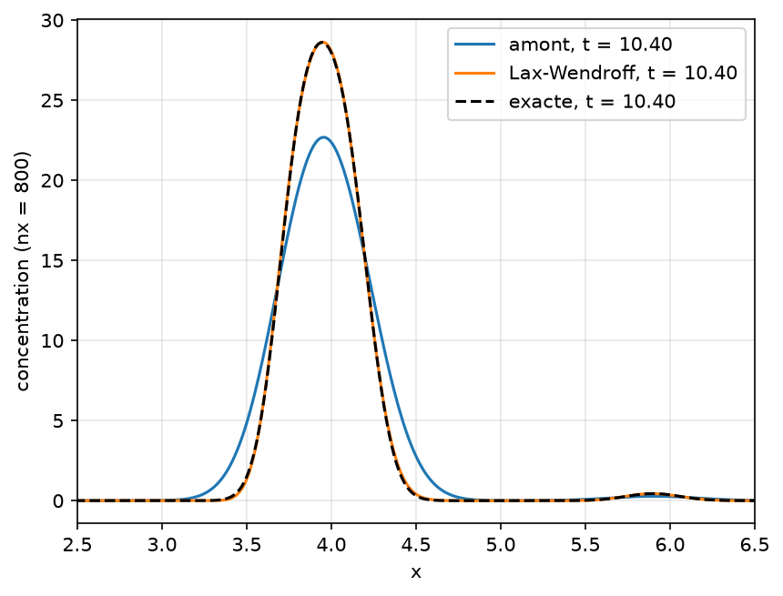
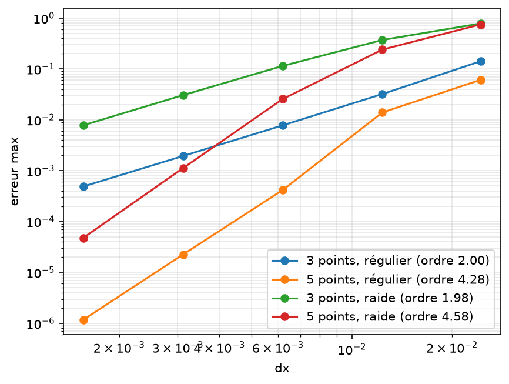
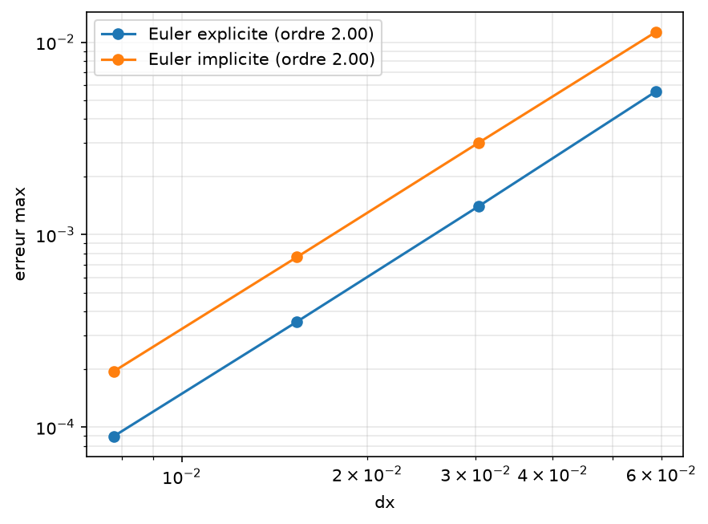
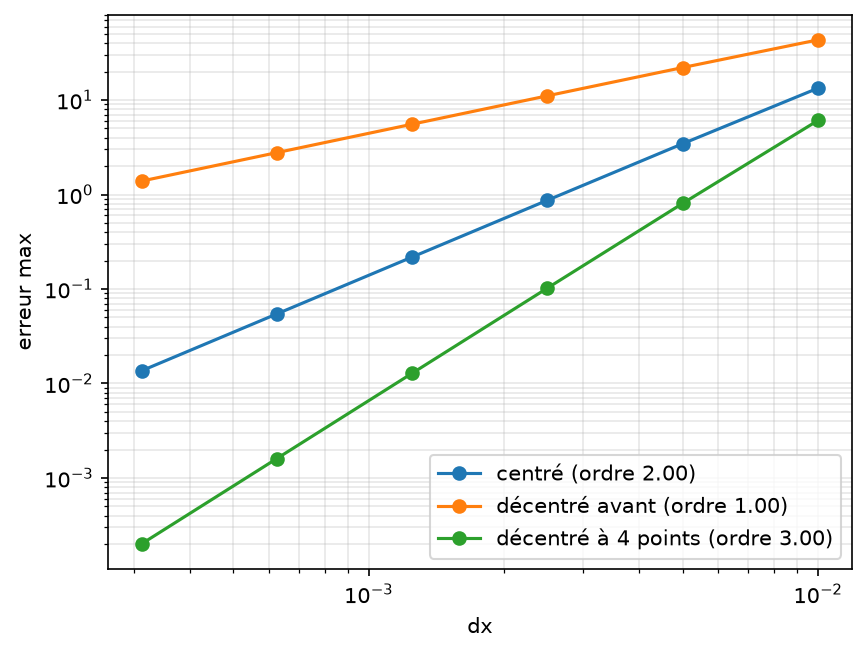

# EDP en différences finies – Fortran

Quatre programmes issus de TP d'EDP (ENSEIRB-MATMECA, 2026), sans bibliothèque externe. Chaque dossier est autonome : `make`, puis `./exe`, qui lit `parametres.dat`.

| Dossier | Problème | Schémas |
|---|---|---|
| `derivees` | dérivée première | centré, décentré avant, décentré à 4 points |
| `poisson_1d` | −u″ = f, Dirichlet | 3 points (Cholesky), 5 points (LU) |
| `chaleur` | équation de la chaleur 1D | Euler explicite, Euler implicite (Cholesky) |
| `transport` | transport-diffusion d'un polluant | amont, centré, Lax-Wendroff |

## Résultats
Ordres mesurés en norme infinie sur les deux grilles les plus fines.

| Cas | Ordre |
|---|---:|
| Dérivée : centré / décentré avant / 4 points | 2,00 / 1,00 / 3,00 |
| Poisson régulier : 3 points / 5 points | 2,00 / 4,28 |
| Poisson raide (ε = 0,005) : 3 points / 5 points | 1,98 / 4,58 |
| Chaleur : explicite / implicite (dt ∝ dx²) | 2,00 / 2,00 |

Pour le schéma à 5 points, le régime asymptotique n'est pas atteint : 4,10 (régulier) et 3,19 (raide) sur la grille suivante.

Transport : erreur L1 vers t = 10 (instantané le plus proche), par rapport à la solution analytique (Ogata-Banks).

| nx | Amont | Lax-Wendroff |
|---:|---:|---:|
| 200 | 9,03 | 2,86 |
| 400 | 6,66 | 0,709 |
| 800 | 4,29 | 0,127 |
| 1600 | 2,63 | 0,118 |

L'erreur de Lax-Wendroff stagne entre 800 et 1600.






## Tout vérifier
```sh
python3 verifier.py    # gfortran, make, NumPy, Matplotlib
```
